# Sherwood

Sherwood is a fair token launchpad for [Robinhood Chain](https://robinhoodchain.blockscout.com). You name a token, pair the curve with ETH or a Robinhood stock token, and trade it until the raise is full. The same rules apply to every launch: one billion tokens, an 8 ETH target, and a public price that climbs as ETH comes in.

This folder is a Next.js app. The marketing page introduces the product. The desk behind it is where you browse, launch, trade, and mint.

**This build saves launches, fills, and mints in the browser.** Connecting a wallet reads your account and can switch you to Robinhood Chain. A fill updates the local board. It does not move funds on chain.

## Run the app

You need Node.js and npm.

```bash
cd sherwood
npm install
npm run dev
```

Open the address printed in the terminal. A fresh install serves [http://localhost:3000](http://localhost:3000). If that port is already taken, Next.js prints a different one.

| Command | What it does |
| --- | --- |
| `npm run dev` | Start the local app with hot reload |
| `npm run build` | Build the production bundle |
| `npm run start` | Serve the production build |
| `npm run lint` | Run ESLint |

The first screen is the landing page. **Open App** enters the desk.

## Where each screen lives

| Path | Screen | What you do there |
| --- | --- | --- |
| `/` | Landing | Read the product, then enter the app or start a launch |
| `/explore` | Explore | See featured collections, trending curves, and the market |
| `/tokens` | Tokens | Filter and sort every curve |
| `/token/[id]` | Token | Read the chart and buy or sell |
| `/create` | Launch | Open a new curve. `?quote=AAPL` preselects a stock pair |
| `/stocks` | Fair Stocks | Browse the 15 Robinhood stock tokens you can quote |
| `/collections` | Collections | Browse fixed-supply mints |
| `/collections/[slug]` | Mint | Mint a quantity from one collection |
| `/portfolio` | Portfolio | See holdings, launches, and fills for the connected address |
| `/docs` | Docs | Read the curve rules, the stock-pair rule, and the chain |

The header search jumps to a token by name or symbol. The sidebar reaches Portfolio, Create, Fair Stocks, NFTs, and Docs.

## The desk

Every screen except the landing page shares the same chrome.

- **Sidebar.** Sherwood mark, then Portfolio, Create, Fair Stocks, NFTs, and Docs. Hover expands the labels. **Log Out** appears after you connect.
- **Top tabs.** Explore, Tokens, and NFTs.
- **Search.** Matches the board and opens that token.
- **Create.** A menu with **Create Token** and **NFT Collections**.
- **Wallet.** Shows **Connect**, or the short address once you are in. A preview session uses a muted dot. On the wrong chain, the button asks you to switch to 4663.
- **Status bar.** Live, Robinhood Chain, Light or Dark, and the year. The theme is stored on this device.
- **Phone.** The sidebar and status bar hide. A menu button opens the sidebar, and a bottom bar holds Explore, Tokens, Create, NFTs, and Wallet.

Content sits inset from the sidebar and the header on every desk screen.

## Walk through the product

### 1. Start on the landing page

`/` is the marketing page. It does not show the desk sidebar.

The hero states the chain (Robinhood Chain, id 4663) and the three facts that every launch shares: 1 billion supply, an 8 ETH target, and 15 stock pairs. **Explore markets** opens the desk. **Launch a token** opens the create form.

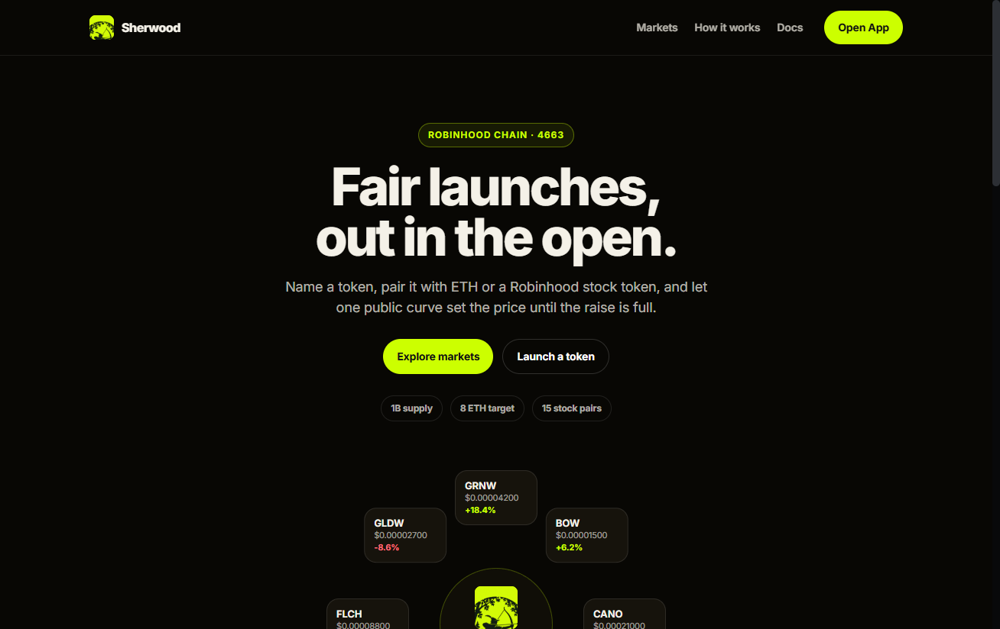

Further down:

- An orbit of live curves. Each card links to that token.
- The 15 stock pairs. A card opens the launch form with that quote already selected.
- Three steps: name the token, choose the pair, trade the curve.
- A short FAQ about browser storage, the preview wallet, the curve, and the stock list.
- A closing call to launch or open the markets.

**Docs** in the landing nav opens the in-app docs, which do use the desk chrome.

### 2. Explore the market

**Open App** lands on `/explore`. Two collection banners sit at the top, each with minted supply, mint price, and a **Mint** button. Under them, six trending curves show symbol, price, and 24-hour change.

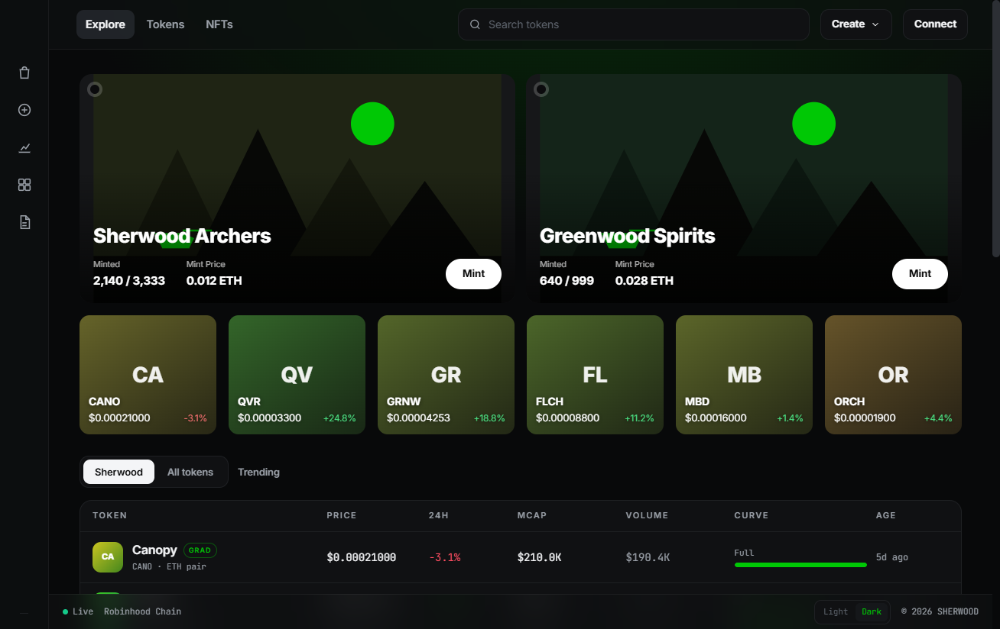

**Sherwood** is the view you are on. **All tokens** opens the filter board. The table under the tiles lists every curve. **New Collections** is a strip of the mint sets.

### 3. Filter the board

**Tokens** (`/tokens`) is the full board. The title is **The board**. Each row shows the token, its quote, price, 24-hour change, market cap, volume, how full the raise is, and age. A filled raise is marked **Grad** and the curve bar reads **Full**.

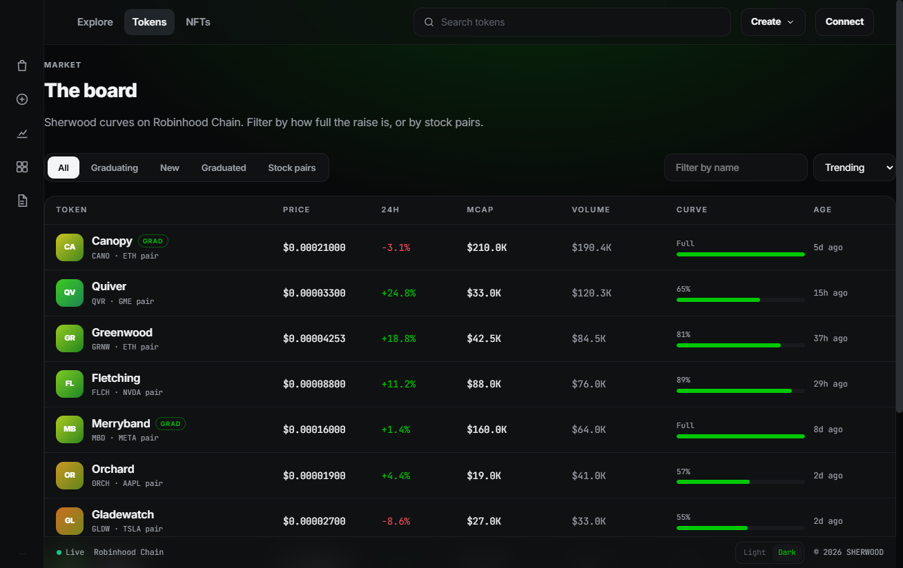

Filters:

| Filter | What it keeps |
| --- | --- |
| All | Every curve |
| Graduating | Open raises that are at least 60% of the 8 ETH target |
| New | Curves opened in the last 48 hours |
| Graduated | Raises that have filled |
| Stock pairs | Curves quoted in a stock token |

Sort by trending, market cap, newest, or amount raised. **Filter by name** narrows the table. Header search is separate: it jumps to the token page.

Trending rank favors 24-hour volume, a positive change, and an open raise.

### 4. Open a token

Click a row or a trending tile. The desk shows the mark, whether the curve is still open or graduated, the quote (ETH or a stock symbol), the price chart, market cap, 24-hour volume, ETH raised, and holder count.

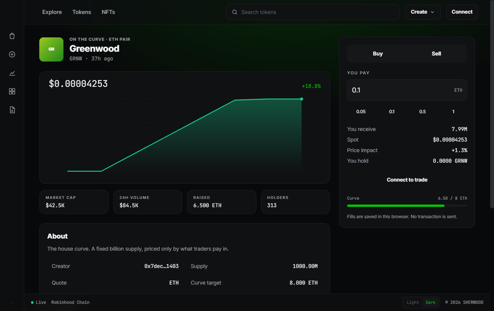

**About** holds the story, the creator address, the 1,000,000,000 supply, the quote, and the curve target. A stock pair also links to that stock token on Blockscout. Recent fills for this curve are listed under the chart.

A missing id, or a curve cleared by a local reset, shows **That curve is not on the board** and a link back to the market.

### 5. Connect a wallet

Trading, launching, and minting ask for a wallet. Use **Connect** in the header, or the button on the trade, launch, or mint panel.

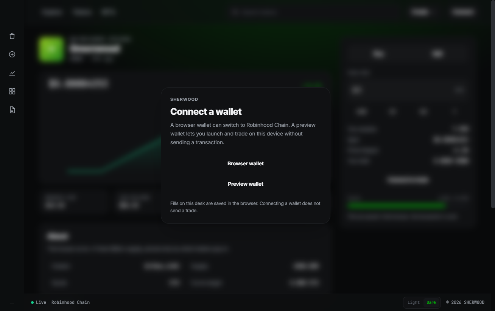

- **Browser wallet** uses an injected wallet such as MetaMask. Sherwood asks it to switch to Robinhood Chain (`4663`, hex `0x1237`). If the chain is missing, Sherwood adds the RPC and the Blockscout explorer, then you can switch.
- **Preview wallet** creates an address on this device. You can launch, buy, sell, and mint with it. No extension is required.

The short address stays in the header. **Log Out** in the sidebar, or the address button, disconnects the session. The preview address is kept, so the same preview wallet still sees its holdings the next time you choose **Preview wallet**.

A browser wallet on another chain shows **Switch to 4663**. Switching the chain still does not send a trade.

### 6. Buy or sell

On a token page, choose **Buy** or **Sell**.

A buy takes ETH. Type an amount or tap `0.05`, `0.1`, `0.5`, or `1`. The panel quotes tokens received, the current spot, price impact, and what you already hold. The smallest buy is 0.0001 ETH. The largest is 20 ETH. If the amount would finish the raise, the fill uses only the ETH still needed and tells you the raise completes.

A sell takes tokens. The chips are 25%, 50%, and Max of what this wallet holds. You receive ETH. A line on the panel states that a 2% fee stays on the curve.

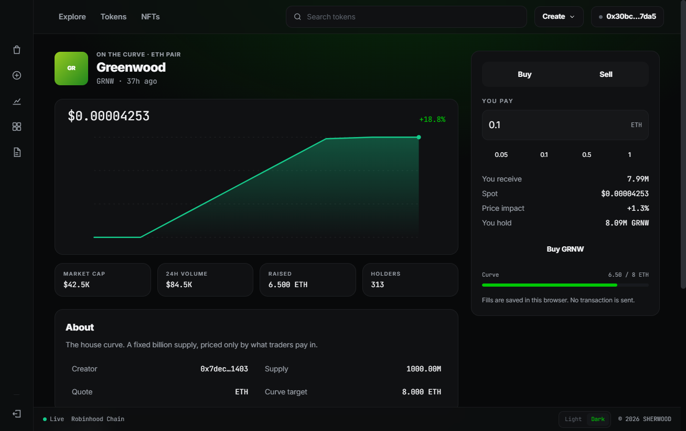

Submit with **Buy SYMBOL** or **Sell SYMBOL**. Price, raised ETH, holders, and the curve bar update on the page. The fill is stored in this browser. With no wallet, the button reads **Connect to trade**.

### 7. Launch a token

Open **Create**, or **Launch a token** on the landing page.

Give the curve a name, a symbol, and a short story. You can attach a picture. The quote is ETH or one of the 15 stock tokens. An optional first buy takes a slice of the curve in the same step as the launch.

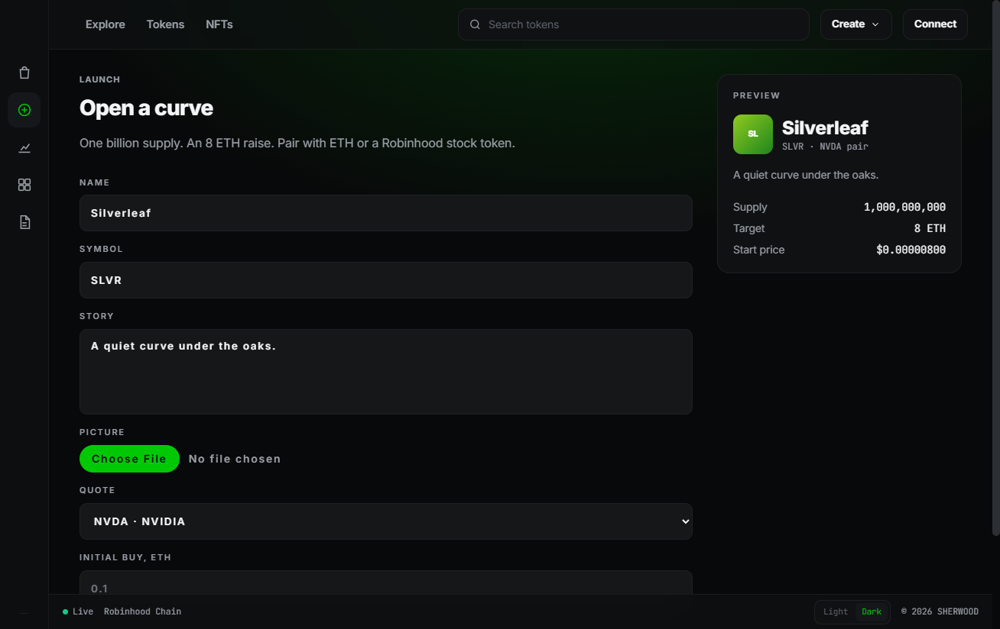

The preview shows the name, the pair, the story, the fixed supply, and the 8 ETH target. A new curve opens at $0.000008.

**Open the curve** publishes the token and opens its desk. It appears on Explore and on the board immediately. With no wallet, the button reads **Connect to launch**.

Opening `/create?quote=NVDA` (or any symbol from the stock list) selects that pair before you type. Landing-page stock cards and **Pair a launch** on the Stocks page both use that link.

### 8. Pair a stock token

**Fair Stocks** lists the 15 canonical Robinhood Chain stock tokens. Each card shows the symbol, the company or fund name, and a shortened contract address.

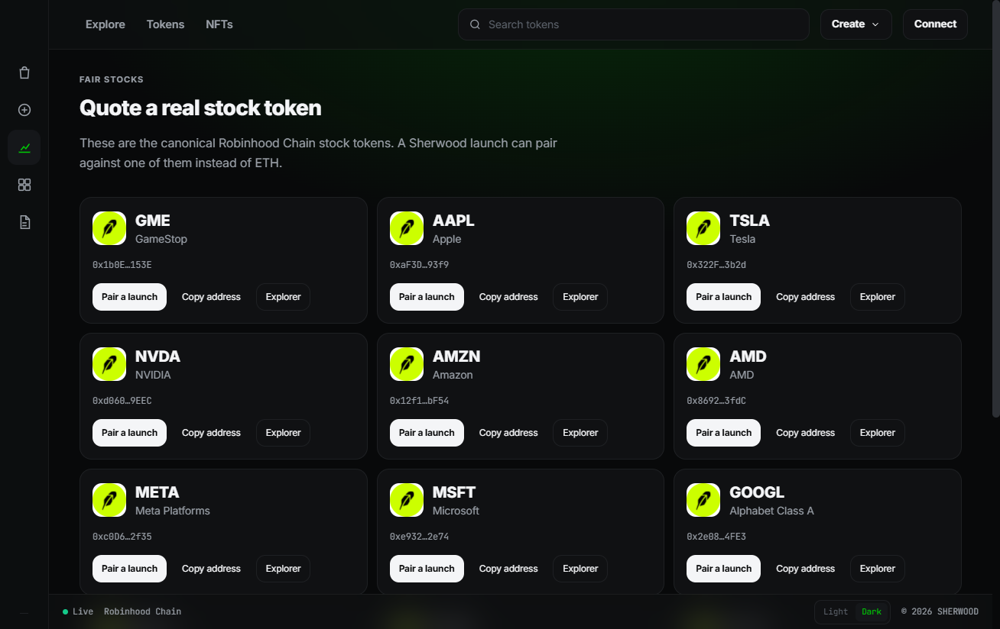

- **Pair a launch** opens the create form with that stock selected.
- **Copy address** copies the contract. The button reads **Copied** for a moment.
- **Explorer** opens the token on Blockscout.

Addresses come from `src/data/stockTokens.json`. The launch form only offers that list. A pasted lookalike address cannot replace the real contract.

The 15 symbols are GME, AAPL, TSLA, NVDA, AMZN, AMD, META, MSFT, GOOGL, NFLX, COIN, PLTR, MSTR, RBLX, and SPY.

### 9. Browse collections

**NFTs**, or **Collections**, is a mint desk separate from the curves. Each set has a fixed supply and a flat mint price. The bar on a card is how much of that supply is already minted.

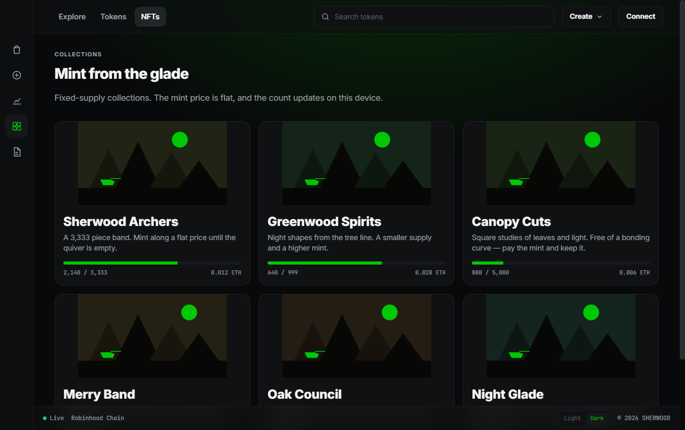

| Collection | Supply | Mint price |
| --- | --- | --- |
| Sherwood Archers | 3,333 | 0.012 ETH |
| Greenwood Spirits | 999 | 0.028 ETH |
| Canopy Cuts | 5,000 | 0.006 ETH |
| Merry Band | 1,500 | 0.02 ETH |
| Oak Council | 250 | 0.08 ETH |
| Night Glade | 4,444 | 0.004 ETH |

The two banners on Explore are Sherwood Archers and Greenwood Spirits. **New Collections** on that page links to the rest.

### 10. Mint

Open a collection, set a quantity, and mint. The panel shows the unit price, the total, how many remain, and how many this wallet has already minted.

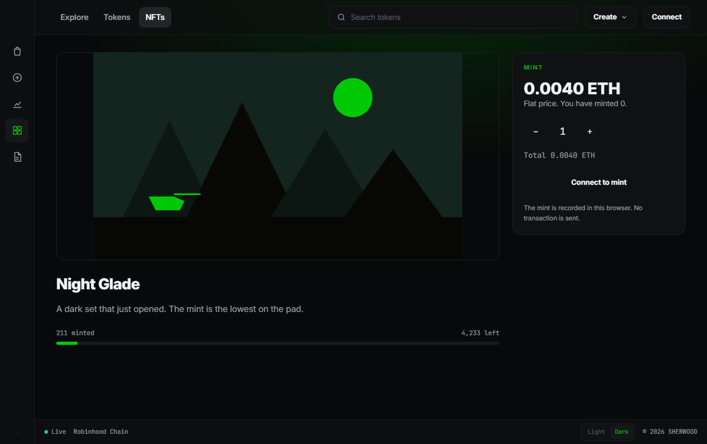

The minted count and the remaining supply update on this device. Minting asks for a wallet the same way a trade does. The charge is recorded locally with the other browser data.

### 11. Check your portfolio

**Portfolio** follows the connected address. With no wallet, the page offers **Connect**.

A preview wallet is labeled as such, and the balances are the ones stored in this browser. A browser wallet shows the chain id it last reported. Fills from that address are still the local fills.

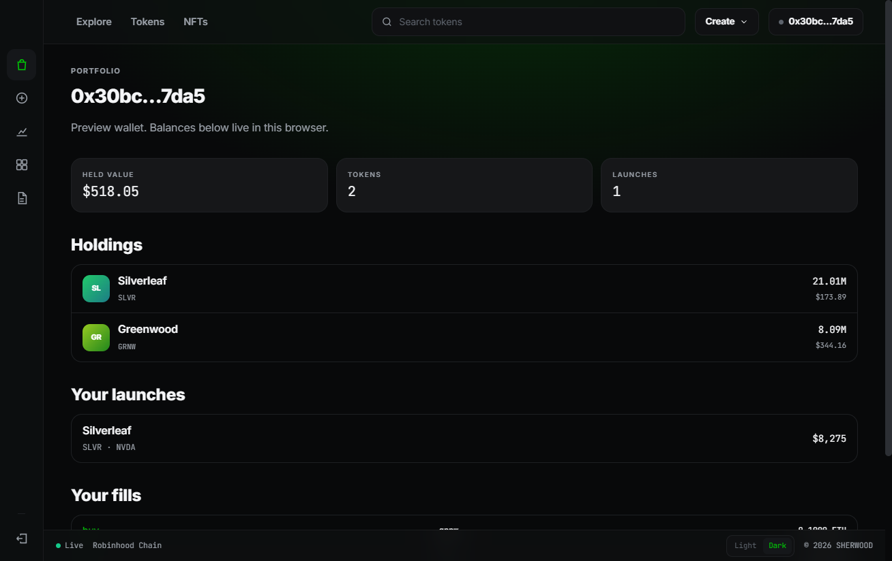

Three figures sit under the address: held value, number of tokens, and number of launches you created. Below that:

- **Holdings** — balance and dollar value for each token you hold. Each row opens the token.
- **Your launches** — curves whose creator is this address, with market cap.
- **Your fills** — the latest buys and sells, with side, token, and ETH amount.

**Reset local market** asks you to confirm, then restores the original seed board. Local launches, balances, fills, and extra mints are cleared. The wallet session and the saved preview address stay.

### 12. Read the rules

**Docs** restates the curve, the stock-pair rule, how this build stores data, and the chain. **Open Blockscout** leaves the app. **Open a curve** and **read the board** jump to Create and Tokens.

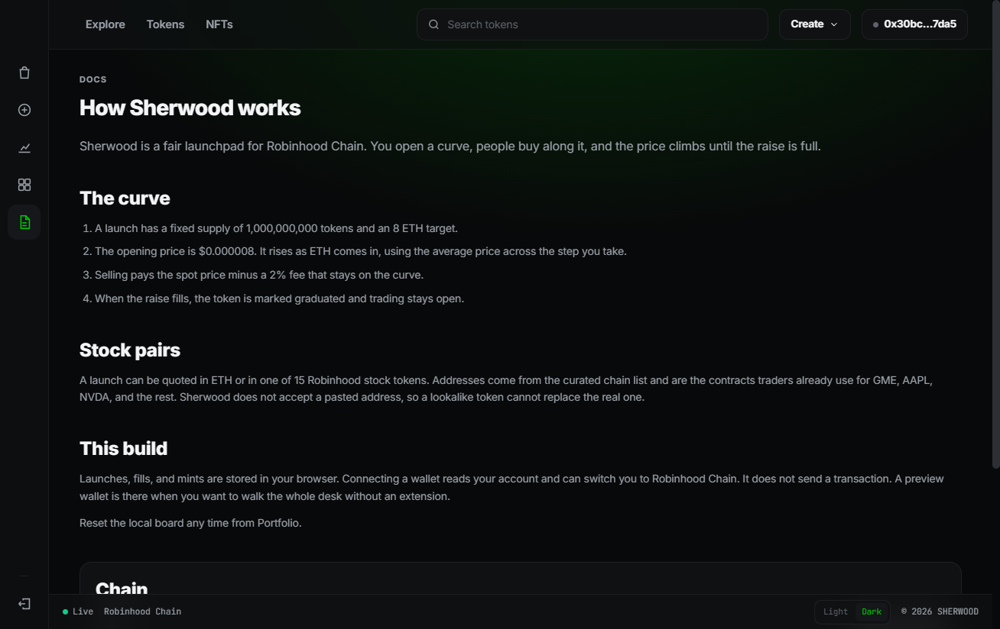

## How a curve works

Every launch uses the same public curve.

| Rule | Value |
| --- | --- |
| Supply | 1,000,000,000 tokens |
| Raise target | 8 ETH |
| Opening price | $0.000008 |
| Slope | 5.5 |
| ETH quote used for conversion | $3,420 |
| Sell fee | 2% |
| Buy size | 0.0001 ETH to 20 ETH |

While the raise is open, progress is ETH raised divided by 8. Spot price is the opening price times `(1 + progress × 5.5)`. At the start, progress is 0 and the spot is $0.000008. When the raise is full, progress is 1 and the spot is $0.000052.

A buy is priced at the average of the spot at the start of the step and the spot at the end. Tokens received are `(ETH spent × 3420) / that average`. The $3,420 figure is a fixed conversion used by this desk. It is a quote constant, not a live oracle.

If a buy is larger than the ETH still needed, only the remaining room is filled and the token graduates. The panel says the fill completes the raise.

A sell pays the current spot minus 2%. The fee stays on the curve. Before graduation, the ETH paid out cannot exceed the ETH still in the raise, and the spot falls as the raise shrinks.

After graduation the token stays tradable. Further buys do not add to the 8 ETH target. The price still moves with the size of the fill. The row is marked **Grad** and the curve bar reads **Full**.

Market cap on the board is spot price times the full supply.

## The opening board

A new browser starts from a seed market so Explore and Tokens are not empty. The seed curves include ETH pairs and stock pairs, and two of them are already graduated:

| Token | Symbol | Quote |
| --- | --- | --- |
| Greenwood | GRNW | ETH |
| Longbow | BOW | ETH |
| Canopy | CANO | ETH, graduated |
| Quiver | QVR | GME |
| Orchard | ORCH | AAPL |
| Nightshade | NSHD | ETH |
| Fletching | FLCH | NVDA |
| Gladewatch | GLDW | TSLA |
| Yeoman | YMN | ETH |
| Merryband | MBD | META, graduated |

Anything you launch is added on top of this list and saved on the device. **Reset local market** on Portfolio puts the seed board back.

## What is saved in this browser

| Key | What it holds |
| --- | --- |
| `sherwood-market-v1` | Curves, fills, balances, and mints |
| `sherwood-wallet-v1` | Whether the session is a browser wallet or a preview wallet, and the address |
| `sherwood-preview-address` | The preview address, kept after you disconnect |
| `sherwood-theme` | `dark` or `light` |

Clearing site data for this origin removes the board, the wallet session, and the theme. **Reset local market** only restores the market. It leaves the wallet and the theme alone.

## Chain

| | |
| --- | --- |
| Name | Robinhood Chain |
| Chain id | 4663 (`0x1237`) |
| Native coin | ETH |
| RPC | `https://rpc.mainnet.chain.robinhood.com` |
| Explorer | [robinhoodchain.blockscout.com](https://robinhoodchain.blockscout.com) |

Stock-token addresses in `src/data/stockTokens.json` are the canonical contracts for chain 4663. The app links out to those contracts. It does not submit a swap or a transfer to them.

## Project layout

| Path | What it is |
| --- | --- |
| `src/app/page.tsx` | Landing page |
| `src/app/(desk)/` | Desk routes. The `(desk)` folder does not appear in the URL |
| `src/components/` | Screens, the desk chrome, the trade panel, and the wallet dialog |
| `src/lib/curve.ts` | Price, buy quote, and sell quote |
| `src/lib/market.tsx` | Board state, wallet session, and browser storage |
| `src/lib/seed.ts` | Opening curves and collections |
| `src/data/stockTokens.json` | The 15 Robinhood stock tokens |
| `src/app/globals.css` | Desk theme, sidebar, and page padding |
| `src/app/landing.css` | Landing page styles |

The stack is Next.js, React, TypeScript, and Tailwind CSS. Inter and JetBrains Mono are bundled with the app.
